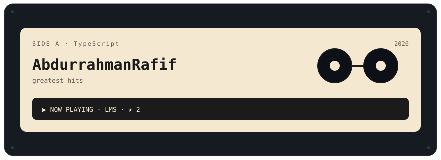

  

Informatics engineering student in Semarang, Indonesia. I build web apps with TypeScript.

`LINER NOTES`

Studying informatics engineering at Universitas PGRI Semarang since 2024, after software engineering at SMK Luqman Al Hakim Kudus. Currently building [TeaMusic](https://teamusic.my.id) and a learning management system for SMK Mataram.

`TRACKLIST`

Most-starred repositories, rebuilt every Monday.

<!-- TRACKLIST:START -->
01. **[LMS](https://github.com/rafifhardjaa/LMS)** — ★ 2 · TypeScript
02. **[Al-amin](https://github.com/rafifhardjaa/Al-amin)** — ★ 2 · SCSS
03. **[mySite](https://github.com/rafifhardjaa/mySite)** — ★ 1 · Astro
04. **[PidApple](https://github.com/rafifhardjaa/PidApple)** — ★ 1 · Svelte
05. **[TeaMusic](https://github.com/rafifhardjaa/TeaMusic)** — ★ 1 · TypeScript
06. **[SdkAds](https://github.com/rafifhardjaa/SdkAds)** — ★ 1 · TypeScript
07. **[Raibanimelist](https://github.com/rafifhardjaa/Raibanimelist)** — ★ 1 · TypeScript
08. **[Radja-Personal-webPage](https://github.com/rafifhardjaa/Radja-Personal-webPage)** — ★ 1 · HTML
<!-- TRACKLIST:END -->

`SIDE B`

`TypeScript` `React` `Next.js` `SvelteKit` `Astro` `ElysiaJS` `Bun` `PostgreSQL` `Supabase` `Tailwind CSS` `Docker` `Git`

  

`CONTACT`

[GitHub](https://github.com/rafifhardjaa) · [LinkedIn](https://linkedin.com/in/rafifhardjaa) · [X](https://twitter.com/rafifhardjaa) · [teamusic.my.id](https://teamusic.my.id) · [rafifhardjaa.dev](https://rafifhardjaa.dev)

tracks are repos · plays are stars · the tape and the bars rebuild weekly from the GitHub API
